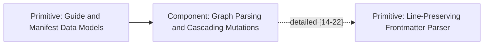

# Localized 1-Hop Mermaid Graph Generator

Full-graph Mermaid diagrams quickly become unreadable hairballs once a knowledge graph grows past 20 nodes. To provide crisp, contextual visualization on each guide page (and via `qst view --guide`), `internal/ssg/mermaid.go` implements `BuildGuideMermaid`, which renders a **localized forward-only 1-hop neighborhood** in a left-to-right (`graph LR`) monochrome academic layout.

## Collision-Safe Node ID Sanitization (`cleanMermaidID`)

Guide IDs often contain spaces, punctuation, or leading digits (e.g., `"1. Intro & Setup"` and `"1 - Intro Setup"`) that would break Mermaid syntax or collide when stripped to alphanumeric characters. `BuildGuideMermaid` sorts the 1-hop node set deterministically and resolves collisions with an incrementing suffix counter:

```go
clean := cleanMermaidID(id)
candidate := clean
counter := 1
for usedIDs[candidate] {
	counter++
	candidate = fmt.Sprintf("%s_%d", clean, counter)
}
usedIDs[candidate] = true
nodeIDs[id] = candidate
```

## Academic Node Labels and Edge Encodings



1. **Capitalized Scope Prefix (`formatGuideNodeLabel`)**: Every node label is formatted as `"<Scope>: <Title>"` with quotes escaped as `#quot;`.
2. **Edge Semantics**:
   * **Prerequisites**: Solid directed arrows (`prereqNode --> currentNode`).
   * **Sub-Guides**: Dotted directed arrows (`currentNode -.->|"adherence [segment]"| subNode`) annotated with the adherence level and line segment range.
3. **Interactive Navigation (`ClickURLFunc`)**: When rendering for HTML guide pages, `BuildGuideMermaid` emits URL-escaped `click <nodeID> href "<escapedPath>"` directives so clicking any neighboring node in the diagram navigates directly to that guide.
