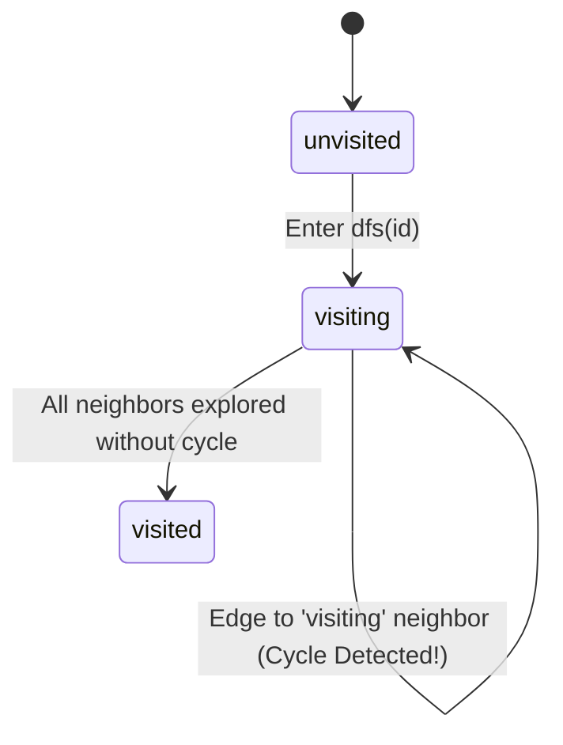

# Three-Color DFS Cycle Detection

A knowledge graph must remain strictly acyclic across both **horizontal prerequisite edges** and **vertical sub-guide edges**. In `internal/graph/validator.go`, `CheckAcyclic` implements a deterministic three-color Depth-First Search (DFS) that both detects cycles in $O(V + E)$ time and reconstructs the exact human-readable cycle chain.

## Three-Color State Machine

Each guide ID in the traversal maintains one of three states:

```go
const (
	unvisited = 0 // White: node has not been visited yet
	visiting  = 1 // Gray:  node is on the active recursion stack
	visited   = 2 // Black: node and all its descendants are verified acyclic
)
```



## Deterministic Traversal and Cycle Reconstruction

Because Go map iteration order is randomized, iterating directly over `map[string]Guide` would produce non-deterministic error messages when a graph contains multiple cycles. `CheckAcyclic` sorts all guide IDs alphabetically before initiating outer DFS roots.

At each node, `dfs(id)` collects both `Prerequisites` and `SubGuides` into a unified `neighbors` slice and pushes `id` onto the active `path` stack:

```go
if state[neighborID] == visiting {
	cycleStart := -1
	for i, node := range path {
		if node == neighborID {
			cycleStart = i
			break
		}
	}
	var cycleChain []string
	if cycleStart != -1 {
		cycleChain = append(append([]string(nil), path[cycleStart:]...), neighborID)
	}
	return fmt.Errorf("cycle detected in graph: %s", strings.Join(cycleChain, " -> "))
}
```

By slicing `path[cycleStart:]` from the ancestor where `neighborID` first entered the recursion stack, the error message strips unrelated prefix nodes and reports only the minimal closed loop (e.g., `cycle detected in graph: GuideA -> GuideB -> GuideA`).
