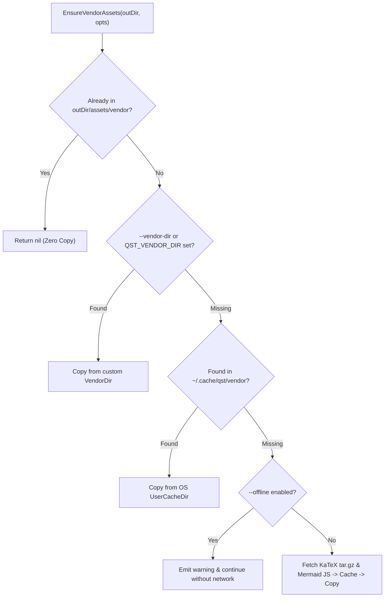

# Vendor Asset Acquisition and Caching

Compiled `qst` sites rely on **KaTeX** (for $\LaTeX$ math rendering) and **Mermaid.js** (for interactive diagrams). Rather than embedding megabytes of third-party font and JavaScript bundles inside the Go binary or forcing CDN dependencies on viewers, `internal/ssg/download.go` implements a 4-tier resolution pipeline (`EnsureVendorAssets`) with persistent local caching and full offline support.

## Four-Tier Asset Resolution Order

1. **Target Inspection (`hasKaTeX`, `hasMermaid`)**: Checks whether `katex/katex.min.css` and `mermaid/mermaid.min.js` already exist in `outDir/assets/vendor`. During `qst serve`, this allows subsequent rebuilds (with `SkipVendor: true`) to bypass asset copying completely.
2. **Custom Vendor Directory**: Checks `--vendor-dir` (or `QST_VENDOR_DIR`), enabling air-gapped CI environments to supply pre-bundled assets.
3. **OS User Cache (`ResolveUserCacheDir`)**: Uses `os.UserCacheDir()` (`~/.cache/qst/vendor` on Linux, `~/Library/Caches/qst/vendor` on macOS) so assets are downloaded only once per machine.
4. **Network Acquisition & Safe Tar Extraction**: Downloads KaTeX `v0.16.9` (`katex.tar.gz`) and Mermaid `v10` (`mermaid.min.js`) using a 30-second timeout HTTP client, extracting the gzipped tarball through `extractTar` (which enforces the same Zip Slip path traversal check as `.kng` archives).
