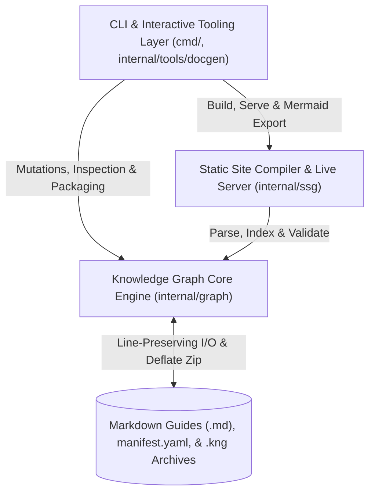

# qst System Architecture

`qst` ("Quest") is a lossless compression, validation, and static site compilation system for structured human knowledge. It models a subject domain as a two-dimensional Directed Acyclic Graph (DAG) of Markdown guides governed by horizontal **prerequisite** chains and vertical **sub-guide** decompositions.

## 1. The Knowledge Graph Core Engine (`internal/graph`)

At the foundation of the repository is `internal/graph`, a pure domain package with zero UI or HTTP dependencies. It defines the core `Guide` and `Manifest` data models, parses YAML frontmatter while preserving exact CRLF/LF line endings and post-frontmatter body line counts, executes reference-safe cascading mutations across guides and tours, validates horizontal scope equality, vertical scope hierarchy, segment line coverage, and 3-color DFS acyclicity, builds inverted graph indices (`GraphIndex`), and packages portable `.kng` Deflate archives with Zip Slip protection.

## 2. The Static Site Compiler and Live Server (`internal/ssg`)

Sitting above the graph engine is `internal/ssg`, which compiles a knowledge graph into a self-contained academic website (`qst build`) or serves it dynamically (`qst serve`). It transforms guide Markdown via custom Goldmark AST transformers that rewrite `.md` links and inject `#L<n>` line anchors, synthesizes localized 1-hop `graph LR` Mermaid diagrams, manages a 4-tier offline-capable cache for KaTeX and Mermaid vendor assets, builds top-down course syllabi and session-persistent sidebars, and runs an `fsnotify` + Server-Sent Events (`/_qst/events`) live-reloading dev server with real-time validation overlays.

## 3. The CLI and Interactive Tooling Layer (`cmd/`, `internal/tools/docgen`)

At the outer boundary is `cmd/` and `internal/tools/docgen`, which expose `qst`'s capabilities through a testable Cobra CLI hierarchy and interactive `charm.land/huh/v2` terminal forms. By routing all I/O through captured Cobra streams and an interceptable `exitFunc`, every authoring, inspection (`inspect`, `coverage`, `stats`, `view`), compilation (`build`, `serve`), and archiving (`form`, `free`) command is verified in-process alongside automated CLI documentation parity (`docgen`) in CI.
